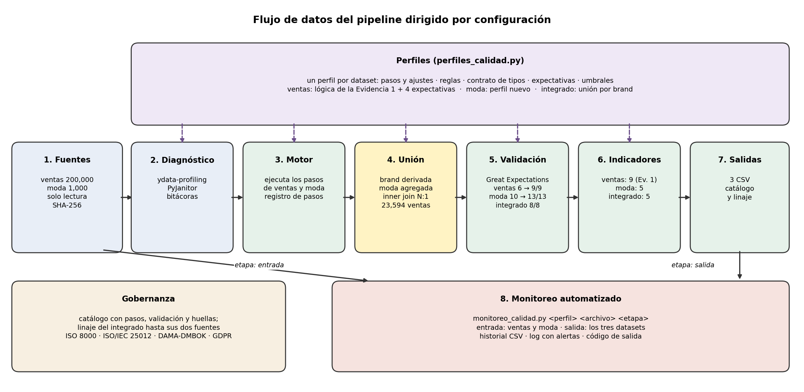
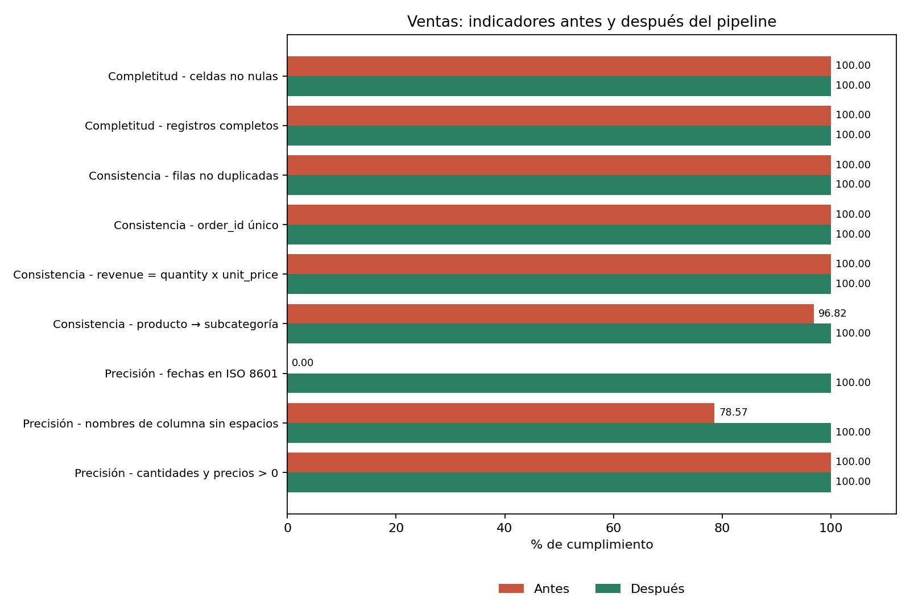
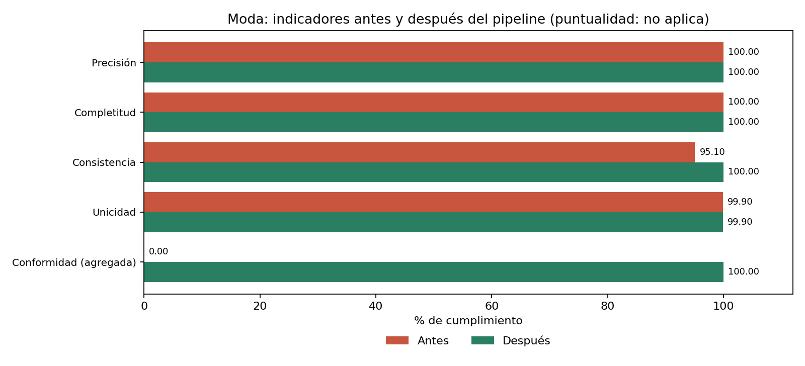
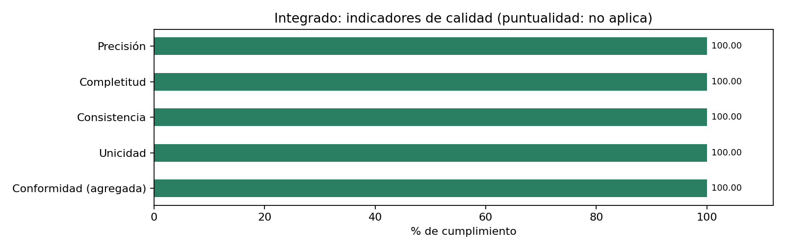
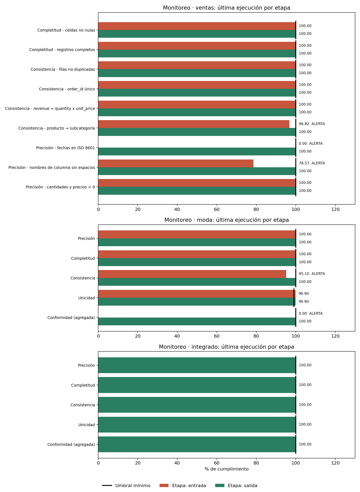

# Evidencia final · Gestión de calidad de datos

**Ampliación del pipeline de calidad: integración de `fashion_products.csv`, unión por marca y rediseño dirigido por configuración**

| | |
|---|---|
| **Nombre** | Gabriel Enrique Baltazar Loyola |
| **Matrícula** | AL07167121 |
| **Materia** | Gestión de calidad de datos |
| **Fecha** | 28 de octubre de 2026 |

---

## 1. Contexto y objetivo

En la Evidencia 1 se construyó un pipeline de calidad para `product_sales_dataset_final.csv` (200,000 ventas): diagnóstico, limpieza documentada, seudonimización del cliente y validación con Great Expectations. Esta evidencia lo amplía en tres frentes:

- **Integración de un dataset nuevo**, `fashion_products.csv` (1,000 calificaciones de productos de moda), que conserva su propia estructura y adopta las convenciones del pipeline.
- **Unión de ambos datasets mediante un campo**, la marca, para generar un dataset nuevo: `ventas_con_calificaciones.csv`.
- **Rediseño del pipeline**, que pasa de código monolítico a uno dirigido por configuración, capaz de procesar ambos datasets con el mismo código.
- **Operación continua**, con indicadores en varias dimensiones, monitoreo automatizado con alertas y una capa de gobernanza (catálogo, linaje y conservación).

## 2. Diagrama del flujo de datos



El código de la Evidencia 1 estaba escrito para las columnas de ventas; procesar otro dataset obligaba a copiarlo y editarlo. El rediseño separa tres piezas:

| Pieza | Archivo | Función |
|---|---|---|
| Pasos | `pasos_calidad.py` | 16 transformaciones genéricas; ninguna conoce un dataset concreto |
| Perfiles | `perfiles_calidad.py` | Un perfil de configuración por dataset, solo con datos: pasos y ajustes, reglas, contrato de tipos, expectativas y umbrales |
| Motor | `motor_calidad.py` | Ejecuta en orden los pasos configurados en el perfil indicado y registra cada uno |

Además de los perfiles de ventas y moda hay un tercero, `integrado`, que une ambos (sección 3.4). Ocho pasos son comunes a ventas y moda, como normalizar nombres, imputar o seudonimizar. Los demás son propios de cada uno: ventas convierte fechas y moda marca posibles duplicados. La limpieza, Great Expectations, los indicadores y el monitoreo leen el mismo perfil, así que nunca aplican reglas distintas. Agregar una fuente nueva consiste en escribir un perfil, sin modificar el motor.

**Equivalencia con la Evidencia 1.** El perfil de ventas reproduce la lógica original. El notebook lo comprueba contra los resultados guardados de la Evidencia 1: coinciden las filas afectadas por los 11 pasos originales, los 9 indicadores antes y después, y el tamaño final (200,000 × 14). El único paso nuevo en el registro, "Asegurar quantity entero", documenta una conversión que antes se hacía sin registrarse.

## 3. Integración del nuevo dataset

### 3.1 Origen y formato

| Atributo | Valor |
|---|---|
| Origen | Conjunto sugerido por el curso; la fuente original no está verificada |
| Formato | CSV, separador coma, UTF-8, con encabezado |
| Tamaño | 1,000 registros × 9 columnas (64 KB) |
| Granularidad | Un registro = una calificación de un usuario a un producto |
| Relación con ventas | Ambos describen productos de comercio minorista; ventas ya incluía la categoría *Clothing & Apparel* |

El dataset presenta indicios de ser sintético: distribuciones categóricas casi uniformes, `rating` con 13 a 16 decimales y precios sin diferencia entre marcas. Se procesa tal cual, sin usar sus resultados para describir consumidores reales.

### 3.2 Variables y coherencia con el pipeline

| Original | En el pipeline | Tipo | Significado | Relación con ventas |
|---|---|---|---|---|
| User ID | `user_key` | texto | Usuario que califica (seudónimo) | Mismo tratamiento que `customer_key` |
| Product ID | `product_id` | entero | Identificador único del registro | Clave única, como `order_id` |
| Product Name | `product_name` | texto | Tipo de prenda (5 valores) | Mismo nombre, otro nivel: en ventas es el producto específico |
| Brand | `brand` | texto | Marca (5 valores) | Sin equivalente |
| Category | `category` | texto | Segmento de público | Mismo nombre, otro significado: en ventas es el tipo de producto |
| Price | `price` | decimal | Precio; moneda no especificada | Equivale a `unit_price` |
| Rating | `rating` | decimal | Calificación de 1 a 5 | Sin equivalente |
| Color | `color` | texto | Color (6 valores) | Sin equivalente |
| Size | `size` | texto | Talla (S, M, L, XL) | Sin equivalente |

La coincidencia con el pipeline se exige en las convenciones, no en las columnas. Ambos datasets usan nombres en *snake_case*, los mismos tipos lógicos, precio decimal, seudónimo SHA-256 con sal, una suite de Great Expectations propia y el mismo script de monitoreo. Las 9 columnas de moda y las 14 de ventas cumplen el contrato de nombre y tipo de su perfil.

### 3.3 Transformaciones de moda

Los 12 pasos del perfil quedan en `registro_limpieza.csv`, con filas afectadas, técnica y característica de ISO/IEC 25012. Los que modifican datos son:

- **Nombres a *snake_case*:** los 9 nombres tenían mayúsculas o espacios.
- **`price` de entero a decimal** (1,000 filas), igual que `unit_price` en ventas.
- **Corrección de 49 registros de *Dress* en *Men's Fashion*** a *Women's Fashion*, la moda de *Dress* entre los registros válidos (74, frente a 53 de *Kids'*). Es la técnica que la Evidencia 1 aplicó a la subcategoría. Cada registro queda marcado en `category_corregida`.
- **Posible duplicado marcado, no eliminado** (`posible_duplicado`): un par con el mismo usuario, producto, marca, categoría, color y talla, pero con precio y rating distintos.
- **Seudonimización de `user_id`** con SHA-256 y sal secreta. Con solo 100 identificadores, un hash sin sal se revertiría probando los 100 valores.

Los pasos de verificación sin hallazgos (espacios, duplicados exactos, valores fuera de rango o de catálogo, nulos) se ejecutan igual, para dejar constancia y cubrir cargas futuras.

### 3.4 Unión por campo: dataset integrado

Ventas y moda no comparten una columna, así que el campo de unión se deriva. Se eligió la **marca** porque representa exactamente la misma entidad en ambos datasets: en ventas aparece al inicio del nombre del producto (*Nike* Air Force 1, *Zara* Blouse) y en moda es la columna `brand`. La alternativa era la subcategoría de ventas mapeada al segmento de moda (*Men's Wear* → *Men's Fashion*): habría cubierto más ventas (37,383), pero es un mapeo interpretado entre dos clasificaciones distintas, no una coincidencia directa.

El perfil `integrado` configura dos pasos:

1. **Derivar `brand` en ventas** cuando `product_name` empieza con una marca del catálogo de moda.
2. **Unir con moda agregada por marca.** Moda tiene una fila por calificación, y unirla tal cual multiplicaría cada venta. Primero se resume a una fila por marca (`brand_avg_rating` y `brand_rating_count`) y después se une con validación muchos a uno, que detiene el pipeline si una venta encontrara más de una marca.

Se usó **inner join**: el dataset nuevo contiene solo ventas con marca en moda, todas completas. Con *left join*, la mayoría de las filas tendría vacías las columnas de moda y la completitud caería por el diseño de la unión, no por un problema de calidad.

| Resultado de la unión | Valor |
|---|---|
| Ventas integradas | 23,594 de 200,000 (11.8 %) |
| Por marca | Nike 12,548 · Zara 5,606 · Adidas 5,440 |
| Marcas de moda sin ventas | Gucci, H&M |
| Ropa de marcas ausentes en moda | Levi's, GAP, Old Navy, Under Armour, Carter's, Crocs, Timberland |
| Estructura | 17 columnas: las 14 de ventas + `brand`, `brand_avg_rating`, `brand_rating_count`; las 17 cumplen el contrato |

Las calificaciones promedio por marca son casi iguales (entre 2.88 y 3.00), algo esperable si moda es sintético. El dataset integrado demuestra el proceso de integración, pero no permite sacar conclusiones de negocio sobre las marcas.

## 4. Indicadores de calidad

**Ventas** conserva los 9 indicadores de la Evidencia 1 en tres dimensiones: completitud, consistencia y precisión.

**Moda** se mide en cinco dimensiones:

| Dimensión | Definición (% de cumplimiento) |
|---|---|
| Precisión | Registros que cumplen todas las reglas de dominio: `rating` entre 1 y 5, `price` > 0 y las 5 categóricas dentro del catálogo |
| Completitud | Celdas no nulas en las columnas de datos |
| Consistencia | Registros con una combinación producto-categoría válida |
| Unicidad | Registros que no repiten fila, `product_id` ni clave de negocio |
| **Conformidad (métrica agregada)** | Columnas del contrato presentes, en *snake_case* y con el tipo esperado |
| Puntualidad | No aplica |

**Integrado** usa las mismas cinco dimensiones que moda, con reglas propias: la consistencia verifica que `brand` coincida con el inicio de `product_name` y que cada marca tenga un solo valor de calificación, y la unicidad de `order_id` detecta si la unión multiplicó ventas.

**Puntualidad: no aplica a moda ni al integrado.** La puntualidad mide si un dato está vigente cuando se necesita, y para eso hace falta saber cuándo se generó o actualizó. Las calificaciones de moda no tienen fecha de captura ni de actualización, y el integrado hereda esa limitación: no se puede saber si la calificación de una marca estaba vigente al momento de cada venta. Se descartó usar la fecha de descarga del archivo, porque mediría la llegada al pipeline y no la vigencia de los datos.

**Conformidad: métrica agregada en moda y en el integrado.** Sustituye a la puntualidad para mantener cinco indicadores calculables. Es una característica de ISO/IEC 25012, la norma de la Evidencia 1, y mide lo que exige la integración: que los datos nuevos adopten las convenciones del pipeline.

**Precisión** se mide en todos los datasets como exactitud sintáctica, porque no existe un valor de referencia externo contra el cual comparar.







## 5. Comparativo de calidad antes y después

**Ventas** (solo cambian 3 de 9 indicadores; el resto estaba en 100 %):

| Indicador | Antes | Después |
|---|---:|---:|
| Consistencia · producto → subcategoría | 96.82 | 100.00 |
| Precisión · fechas en ISO 8601 | 0.00 | 100.00 |
| Precisión · nombres de columna sin espacios | 78.57 | 100.00 |

**Moda:**

| Indicador | Antes | Después |
|---|---:|---:|
| Precisión | 100.00 | 100.00 |
| Completitud | 100.00 | 100.00 |
| Consistencia | 95.10 | 100.00 |
| Unicidad | 99.90 | 99.90 |
| Conformidad (agregada) | 0.00 | 100.00 |
| Puntualidad | no aplica | no aplica |

La unicidad de moda se queda en 99.90 % de forma deliberada: el posible duplicado se conserva porque no hay evidencia para eliminarlo.

**Integrado:** no tiene comparación antes/después porque nace en el pipeline. Sus cinco indicadores están en 100 %.

**Great Expectations:**

| Suite | Antes | Después | Expectativas que fallaban antes |
|---|---:|---:|---|
| `contrato_ventas` · Evidencia 1 (5) | 3 | 5 | Formato de `order_date` (200,000 registros); par producto-subcategoría (6,368) |
| `contrato_ventas` · Adicionales (4) | 3 | 4 | Columnas iguales al contrato: la fuente contiene `customer_name` |
| `contrato_moda` (13) | 10 | 13 | Columnas iguales al contrato; `price` decimal; par producto-categoría (49) |
| `contrato_integrado` (8) | — | 8 | Se valida una vez, sobre su salida |

Las expectativas adicionales de ventas (`quantity` ≥ 1, `unit_price` > 0 y `revenue` > `profit`) se cumplían desde el origen. Ahora quedan como controles permanentes para cargas futuras.

## 6. Monitoreo continuo de calidad

`monitoreo_calidad.py` recibe el perfil, el archivo y la etapa. Calcula los indicadores del perfil, los compara con sus umbrales, agrega el resultado a `monitoreo_historial.csv` (con identificador de ejecución, fecha y huella del archivo) y registra en `monitoreo.log` un `WARNING` por cada alerta. Termina con código de salida 1 si hubo alertas, lo que permite programarlo con cron o con el Programador de tareas de Windows.

Los umbrales son de 100 %, excepto la unicidad de moda (99 %), que tolera posibles duplicados no confirmados. El script se ejecuta sobre la entrada de ventas y moda y sobre la salida de los tres datasets:



Evidencia de ejecución (extracto del log):

```
WARNING | afa495d1 | ventas    | entrada | Consistencia - producto → subcategoría: 96.82 % (umbral 100 %) -> ALERTA
WARNING | afa495d1 | ventas    | entrada | Precisión - fechas en ISO 8601: 0.00 % (umbral 100 %) -> ALERTA
WARNING | afa495d1 | ventas    | entrada | Precisión - nombres de columna sin espacios: 78.57 % (umbral 100 %) -> ALERTA
INFO    | afa495d1 | ventas    | entrada | fin: 3 alerta(s)
WARNING | 84a41def | moda      | entrada | Consistencia: 95.10 % (umbral 100 %) -> ALERTA
WARNING | 84a41def | moda      | entrada | Conformidad (agregada): 0.00 % (umbral 100 %) -> ALERTA
INFO    | 84a41def | moda      | entrada | fin: 2 alerta(s)
INFO    | 28933d2c | ventas    | salida  | fin: 0 alerta(s)
INFO    | bd498f6a | moda      | salida  | fin: 0 alerta(s)
INFO    | 750754af | integrado | salida  | fin: 0 alerta(s)
```

Las alertas de la entrada son reales, no simuladas: corresponden exactamente a las deficiencias que el pipeline corrige, y en las salidas desaparecen. En el integrado, la unicidad de `order_id` alertaría si una unión futura multiplicara ventas. En una carga futura, el mismo script detectaría valores fuera de rango, categorías nuevas o columnas renombradas sin intervención manual.

## 7. Principios normativos y éticos aplicados

| Marco | Principio | Aplicación en el pipeline |
|---|---|---|
| ISO 8000 | Procedencia demostrable y conformidad con una especificación | Huellas SHA-256 de entrada y salida; contrato de tipos por perfil; suites de Great Expectations |
| ISO/IEC 25012 | Características de calidad | Bitácoras, registro de pasos e indicadores clasificados por característica |
| DAMA-DMBOK | Gestión de metadatos | Perfiles, diccionario de variables y `catalogo_datos.json` |
| | Gestión de calidad de datos | Ciclo diagnóstico → pipeline → validación → monitoreo |
| | Linaje y gobierno | Pasos registrados por dataset, linaje del integrado hasta sus dos fuentes, columnas de control y rol de *data steward* |
| GDPR | Seudonimización (art. 4.5) y protección desde el diseño (art. 25) | `customer_key` y `user_key` con SHA-256 y sal guardada fuera del código |
| | Minimización (art. 5.1.c) | Se eliminan `customer_name` y `user_id` |
| | Limitación de la conservación (art. 5.1.e) | Política de conservación en el catálogo |
| | Exactitud (art. 5.1.d) y responsabilidad proactiva (art. 5.2) | Reglas de dominio, correcciones documentadas y evidencia auditable |

**Catalogación, trazabilidad y conservación.** El catálogo registra, para cada dataset, sus metadatos (descripción, origen, responsable, clasificación y contrato) y su linaje: archivo y huella de entrada, cada paso aplicado con sus filas afectadas, el resultado de la validación, y archivo y huella de salida. Las entradas del integrado son las salidas de ventas y moda, así que su linaje se puede rastrear, por huellas, hasta los dos archivos originales. Las fuentes se conservan sin cambios, y el notebook lo comprueba recalculando sus huellas al terminar. Las salidas se pueden regenerar desde las fuentes y los perfiles.

**Principios éticos.** Las correcciones son transparentes y reversibles gracias a las columnas de control; no se eliminan datos sin evidencia; el riesgo de cada decisión queda declarado; y se advierte que moda parece sintético para evitar conclusiones engañosas sobre personas reales.

## 8. Reflexión crítica

**Importancia del gobierno de datos.** Integrar una segunda fuente mostró que la calidad no depende solo de limpiar valores, sino de acordar qué significa cada dato. Ventas y moda usan `category` y `product_name` con significados distintos; si se hubieran unido por esas columnas, el resultado habría parecido válido y habría sido incorrecto, sin que ninguna validación técnica lo detectara. Documentar el significado de cada variable fue lo que permitió elegir la marca como el único campo que representa lo mismo en ambos lados. El gobierno de datos convierte esos acuerdos en artefactos verificables: perfiles, contratos, catálogo y suites de validación. El cumplimiento normativo, por su parte, obliga a justificar cada dato personal que se conserva y deja evidencia de cómo se protege.

**Decisiones tomadas.**

- Rediseñar el pipeline por configuración en lugar de duplicar código para el segundo dataset, y comprobar que ventas sigue dando los resultados de la Evidencia 1.
- Conservar la estructura propia de moda y unirla con ventas por la marca, agregando moda primero para no multiplicar ventas, con *inner join* para que el dataset nuevo quede completo.
- Declarar la puntualidad como no aplicable a moda y al integrado en vez de medirla con un sustituto que no representa a los datos, y agregar la conformidad con justificación explícita.
- Corregir la categoría de *Dress* con la moda del producto, y documentar sin alterar el posible duplicado y los ratings con exceso de decimales.

**Riesgos mitigados.**

| Riesgo | Mitigación |
|---|---|
| Cambiar sin querer los resultados de la Evidencia 1 al rediseñar | Verificación automática contra los resultados originales |
| Reglas divergentes entre limpieza, validación y monitoreo | Un solo perfil por dataset, leído por todas las etapas |
| Interpretar igual variables con el mismo nombre y distinto significado | Diccionario con relación explícita frente a ventas; unión por un campo con el mismo significado |
| Multiplicar ventas al unir con moda | Agregación previa por marca, validación muchos a uno, expectativa de `order_id` único y monitoreo de unicidad |
| Reidentificación de clientes y usuarios | Seudónimos con sal secreta y eliminación de los identificadores |
| Corrección equivocada de *Dress* (podría ser *Kids'*) | `category_corregida` hace el cambio rastreable y reversible |
| Eliminar registros legítimos | Posibles duplicados marcados, no borrados |
| Alterar las fuentes originales | Lectura de solo lectura y verificación de huellas SHA-256 |
| Degradación silenciosa en cargas futuras | Monitoreo con umbrales, historial y alertas para ambos datasets |

**Mejoras logradas.** En moda, la conformidad pasó de 0 % a 100 % y la consistencia de 95.1 % a 100 %. Great Expectations pasó de 6 a 9 expectativas cumplidas en ventas y de 10 a 13 en moda, y el integrado cumple sus 8. Frente a la Evidencia 1, el pipeline ganó perfiles reutilizables, un dataset integrado nuevo, cuatro controles adicionales para ventas, monitoreo automatizado, linaje con huellas y un catálogo de metadatos.

**Limitaciones.** La corrección de *Dress* es la mejor evidencia disponible, no una certeza; la puntualidad de moda no se puede evaluar sin fechas; el origen de moda no está verificado; y la unión cubre solo el 11.8 % de las ventas, porque moda incluye pocas de sus marcas. Validar la categoría con el área de negocio y obtener metadatos de la fuente serían los siguientes pasos.

---

**Archivo complementario:** `EvidenciaFinal_AL07167121_GestionDeCalidadDeDatos.ipynb`, que contiene el pipeline completo y genera en `salidas/` los CSV procesados (incluido `ventas_con_calificaciones.csv`), el catálogo, el historial y el log de monitoreo, los perfiles HTML y las figuras.
